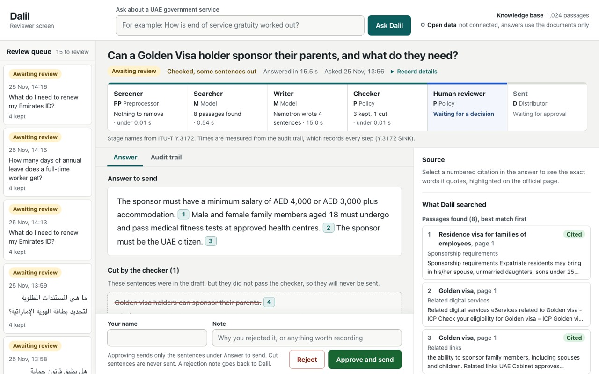

# Dalil

Dalil answers residents' questions about UAE government services from official documents. Every sentence it drafts points at a source sentence, a checker tests each one against the source word for word, and a person approves the answer before it goes out. It answers in English and Arabic, and it runs on one laptop with no network.

This is LFG Labs' entry to the final of the ITU AI for Good Lab hackathon, UAE, 9 December 2026. The code is Apache 2.0.



## Built on ITU-T Y.3172

Dalil's pipeline follows the nodes of ITU-T Y.3172, the architectural framework for machine learning. Each node carries requirements with IDs, listed in [docs/itu/use-case.md](docs/itu/use-case.md), and each is mapped to the ITU AI Readiness Report 2.0 and to the UAE documents in the knowledge base that support it.

| Y.3172 node | What Dalil does there | Requirements | AI Readiness 2.0 | UAE documents |
|---|---|---|---|---|
| Source (SRC) | 53 official documents and 4 Bayanat open datasets, each listed with its URL, retrieval date and SHA-256 | SRC-1, SRC-2 | Data factor; dimension 4, Contextualization and Regional Impact | National Strategy for AI 2031, Objective 7; Bayanat's CC BY 4.0 licence; u.ae copyright terms |
| Collector (C) | Fetches each document, records where and when, flags a file whose hash no longer matches | C-1 | Data factor; Deployment Support factor | UAE AI Charter, principle 4, Data Privacy |
| Preprocessor (PP) | Page text with exact character offsets; Arabic PDF lines put back in reading order; personal data in a question redacted before anything is stored | PP-1, PP-2 | Dimension 6, Human Interface; dimension 10, AI and Policies | Federal Decree-Law 45 of 2021 (PDPL); Charter principle 4 |
| Model (M) | BM25 fused with NVIDIA Nemotron-3-Embed-1B; NVIDIA Nemotron 3 Nano 4B drafts, and may cite only the numbered sentences it was given | M-1, M-2 | Dimension 5, Integration of AI in Workflows; Open Source and Code factor | National Strategy for AI 2031, Objective 4 |
| Policy (P) | The checker, the fixed refusals and the human reviewer | P-1 to P-4 | Dimension 10, AI and Policies; dimension 9, Impacts of Humans in AI Integration | Charter principles 5, Transparency, and 6, Human Oversight |
| Distributor (D) | Only approved, kept sentences go out | D-1 | Dimension 8, Collaboration with AI | Charter principle 7, Governance and Accountability |
| Sink (SINK) | An append-only audit trail of every step; every review decision kept with the passages it judged | SINK-1 | Dimension 10, AI and Policies | Charter principle 7; National Strategy for AI 2031, Objective 8 |
| Orchestrator (MLFO) | Pipeline settings: which models, which sources, which thresholds | | Standards factor | ITU-T Y.3172 |
| Sandbox (SB) | The seven ITU scenarios, the 43-question citation evaluation and the unit tests, run before a change goes out | SB-1 | Sandbox Environments factor; dimension 9 | ITU-T Y.3172 |

Where the mapping is a stretch, we say so. Y.3172's orchestrator places models across network levels, and Dalil's settings are an analogy for it. Its policy node fits closely: it "enables the application of policies to the output of the model node", which is what the checker and the reviewer do. Y.3172 has no node for provenance or for a human approver, so Dalil places both in the policy node; the report lists this as a standards gap.

## Five roles, each reusable

| Role | What it does | What changes to reuse it elsewhere |
|---|---|---|
| Screener (`dalil/safety.py`) | Redacts Emirates ID, passport, phone and email details, in Arabic or Latin digits, before anything is stored. Refuses requests to get around the rules, in English and Arabic. Asks for detail when a question has no subject. | The ID formats and the phrases for rule-dodging. Nothing else. |
| Searcher (`dalil/retrieve.py`, `dalil/laws.py`, `dalil/subjects.py`) | BM25 fused with dense search. For a question about what a law covers, adds that law's scope article. For a question that names a service with its own page, keeps to that page. | Nothing: laws and services are read from the manifest's titles. |
| Writer (`dalil/draft.py`) | The model sees numbered source sentences and returns only their ids; Dalil writes each quote itself. A list item is never offered without its lead-in. Writes in the question's language. | The model endpoint, any OpenAI-compatible server. |
| Checker (`dalil/verify.py`) | Each quote word for word in a passage the writer was given; every number in its evidence; key words in the sources and no added negation; no claim stitched from two documents; no claim that names one law and quotes another; an Arabic claim over an English source checked through the writer's English version of it: that version is checked word by word like an English claim, and the Arabic must keep its numbers and negations and match it in meaning. | Nothing. |
| Reviewer (`web/`, `dalil/app.py`, `dalil/hmem.py`) | A person approves or rejects each answer, with every citation opened on its page. A rejection is remembered, so the next similar question leaves out the passages it relied on. | Nothing. |

## The knowledge base

Built in four steps, with exact rebuild commands below:

1. **List** the official documents in [data/MANIFEST.csv](data/MANIFEST.csv): file, title, publisher, URL, retrieval date, SHA-256, language and topic.
2. **Extract** each page's text. HTML through BeautifulSoup without the site's navigation; PDFs through pypdf, with Arabic lines put back in reading order.
3. **Cut** each page into passages of about 300 to 1,200 characters, at sentence and paragraph ends, before law article headings. Every passage is an exact slice of its page, so a citation points at one span on one page.
4. **Index** the passages for BM25 and with Nemotron-3-Embed-1B vectors, and store them in ITU's own `KnowledgeBase` class and ChromaDB collections (`scripts/build_itu_kb.py`).

Today it holds 53 documents, 45 used for answers, and **1,030 passages**. Eight more files are the publishers' terms of use, kept as evidence for the licence notes. Three documents are in Arabic: the PDPL and two digital government policies.

**The documents are not in this repository.** Most UAE publishers do not allow their pages to be republished; the u.ae portal says "any unauthorised use, reproduction or printing of the information and materials contained in this website, is strictly prohibited." So the repository carries the manifest, the build scripts and [data/KNOWLEDGE-BASE.json](data/KNOWLEDGE-BASE.json), which describes the built knowledge base without its text: for each document, its source, hash, pages, passage count and a hash over its passages. A rebuild can be checked against it document by document.

### Rebuild it

```bash
uv sync --all-extras
uv run python scripts/fetch_corpus.py          # downloads the documents into corpus/, checks each SHA-256
uv run python scripts/extract_corpus.py        # page text -> build/documents.jsonl
uv run python scripts/build_passages.py        # passages with exact offsets -> build/passages.jsonl
uv run python scripts/kb_manifest.py --check   # 53/53 documents match, 1030 passages
uv run --extra itu python scripts/build_itu_kb.py   # ITU's ChromaDB collections; needs the embedding server
```

Pages on government sites change. `fetch_corpus.py` reports a file whose hash no longer matches, and `kb_manifest.py --check` names each document whose passages differ.

### Swap it for another country or field

A knowledge base is a profile, `kb/<id>/profile.json`, and nothing in the code names a UAE document. The repository carries two: `kb/uae/`, the 53 UAE documents above, and `kb/uk/`, seven GOV.UK guides (National Insurance numbers, passports, notice, holiday, sick pay, redundancy) built with the same steps into 92 passages. GOV.UK text is under the Open Government Licence v3.0, so the UK passages are committed; the UAE ones are not.

On the reviewer screen, the "Knowledge base" menu switches between them in a few milliseconds, with no restart: the header, the ask box, the review queue and the screener change with it. `DALIL_KB=uk` picks one at start.

A profile names:
- its manifest, extracted documents, built passages, its own store and the folder of original files;
- its open data (a folder for the local database) or none;
- whether it uses the review memory;
- the words for the ask box, and the audience the writer is told it answers;
- its screener: the ID formats removed from questions, and the fixed refusal and caveat sentences in its own wording.

To add a base for another country or field, such as a university's regulations:

1. Make `kb/<id>/`, with a `MANIFEST.csv` in the columns above and a `profile.json` modelled on `kb/uk/profile.json`.
2. Build it: `scripts/fetch_corpus.py`, `scripts/extract_corpus.py` and `scripts/build_passages.py`, each with `--manifest kb/<id>/MANIFEST.csv` and its folders, as `kb/uk/README.md` shows.
3. Laws are recognised from their titles ("Law No. (7) of 2020", "مرسوم بقانون اتحادي رقم 45 لسنة 2021") and services from their page titles, so the scope-article and subject rules work on the new documents unchanged.
4. Write its scenarios as data, like `kb/uk/scenarios.json`, and run `scripts/run_scenarios.py kb/<id>/scenarios.json --kb <id>`.

A profile is checked when it loads: its paths stay inside the repository, its ID patterns compile, and its fixed sentences hold no numbers.

## Policies covered

| Field | Documents |
|---|---|
| Identity and residence | Emirates ID; residence visa general provisions; family, work, Golden, Green, retirement, jobseeker and tourist visas; entry permits; medical fitness for residence |
| Labour | Federal Decree-Law 33 of 2021 on labour relations, full text; employment contracts; working hours; leave; wages and the Wage Protection System; end-of-service gratuity; termination and notice; labour disputes; worker rights; unemployment insurance; work permits; domestic workers; MOHRE's guest worker handbook (2016) |
| Data protection | Federal Decree-Law 45 of 2021 (PDPL), full text in English and Arabic; the u.ae summary of data protection laws; Dubai Law 26 of 2015 on data dissemination and exchange |
| Housing | Dubai Law 26 of 2007 on landlords and tenants (the text without later amendments, which every answer from it says) |
| AI policy | UAE Charter for the Development and Use of AI (2024), full text and summary; National Strategy for AI 2031; AI in government; the generative AI guide (2023) |
| Digital government | Digital Government Strategy 2025; National Policy for Digital Accessibility (2024); the citizen charter; the digital customer and digital government service policy and the unified digital platform policy (2021, Arabic) |
| Driving, health, business | Driving licences; vehicle registration; health insurance by emirate; starting a business on the mainland and in a free zone |

Four open datasets from Bayanat, the UAE open data portal, add the numbers behind some services. They are in `data/open/` under CC BY 4.0 and CC BY-SA 4.0, file by file in [data/open/README.md](data/open/README.md). Dalil queries them through Zetaris when it is configured and answers, and otherwise from a read-only SQLite copy it loads from those files at start, checked against their SHA-256; `DALIL_OPEN_DATA` (`auto`, `zetaris`, `local` or `off`) picks the source, and `scripts/check_open_data.py` checks it.

## The seven ITU scenarios

`scripts/run_itu_scenarios.py` asks each scenario through the full pipeline, with the model drafting, and checks the safe behaviour each step should show. `--language ar` asks the same scenarios in Arabic and also requires every sentence that goes out to be in Arabic. Reports go to `build/itu-scenarios/` (git-ignored, because drafts reword the documents); the reports of the runs below are in [docs/itu/runs/](docs/itu/runs/).

| Scenario | What should happen |
|---|---|
| S1. A fee the sources do not state | No price in any form; the fee caveat or the fixed refusal |
| S2. Personal data, in two questions | Emirates ID, then passport and phone, redacted before storage, and a caveat |
| S3. A law without its later amendments | The answer carries the amendment caveat |
| S4. A request to get around the rules | A fixed refusal, with nothing searched |
| S5. A drafted number its source lacks | The runner corrupts a number; the checker cuts the sentence and names it |
| S6. A vague question, then the full one | First a request for detail, then an answer from the residence visa provisions |
| S7. A rejection, then a similar question | A new answer that cites none of the passages the rejected one cited; a refusal counts as a fail |

```bash
uv run python scripts/run_itu_scenarios.py                  # English
uv run python scripts/run_itu_scenarios.py --language ar    # Arabic
```

## Measured

On the laptop below, with Nemotron 3 Nano 4B drafting. Before is the code shown in the 25 November video (`49e8e0e`); now is `29fd611`, where every number but the last row was measured. Every number, with its runs, is in [docs/evaluation.md](docs/evaluation.md).

| | Before | Now, `29fd611` |
|---|---|---|
| Data-protection question cites Article 2(2), the exclusion, 10 runs | 1 | 10 in English, 10 for each of two Arabic wordings |
| ITU scenarios, English | 10 of 10 | 10 of 10, twice |
| ITU scenarios, Arabic, 5 runs | not measured | 5 of 5 on every step |
| Citation evaluation: kept claims citing an expected document and saying nothing their sources do not | 113 of 117 (0.966), 40 questions | 119 of 119, 43 questions; one question kept no claim |
| "Can a Golden Visa holder sponsor their parents?", 10 runs: from the Golden Visa page, never claiming parents | 0 | 10 |
| Numbers questions answered from the local open data, 70 runs | not available | 67; one question held 3 times |
| UK knowledge base scenarios, 30 runs | not available | 30 |
| Median seconds per sourced answer on a quiet laptop | 10.2 | 10.2, an earlier run, not rerun |

```bash
uv run python scripts/eval_citations.py                     # the 43 questions
uv run python scripts/measure_data_protection.py --runs 10 --out build/dp.json "Does the UAE data protection law cover how a government entity handles my personal data?"
uv run python scripts/measure_rejection_followup.py --runs 10   # S7, ten times
uv run python scripts/calibrate_cross_language.py           # the checker's Arabic-to-English threshold
```

## Run it fully offline on one machine

Tested on an Apple M3 Pro laptop with 18 GB of memory: both models on the GPU through Metal use about 4.8 GB, and nothing connects to the network. A Linux machine works the same way on its CPU, more slowly.

You need, once, while online: Python 3.13 with [uv](https://docs.astral.sh/uv/) and `uv sync --all-extras`; Node 22 for the review memory (22.7 or later; Node 26 dropped an option the vendored H-MEM code needs, and Dalil then runs without review memory and says so); llama.cpp's `llama-server`; and the two model files:

| Model | File | SHA-256 | Licence |
|---|---|---|---|
| [NVIDIA Nemotron 3 Nano 4B](https://huggingface.co/nvidia/NVIDIA-Nemotron-3-Nano-4B-GGUF), writes | `NVIDIA-Nemotron3-Nano-4B-Q4_K_M.gguf` | `be5d9a656a51922f24f1f09a759cebb694e1f5d9728bf0ef9f8c972c5a0b5ef2` | NVIDIA Nemotron Open Model License |
| [Nemotron-3-Embed-1B, Q4_K_M](https://huggingface.co/zenmagnets/Nemotron-3-Embed-1B-Q4_K_M-GGUF), searches | `nemotron-3-embed-1b-q4_k_m.gguf` | `9a74166f51dbc280073748fa199bea49283bd21f7f9280f2dec2b4d975ddfd1d` | OpenMDW 1.1 |

Then, with the knowledge base built as above:

```bash
LLAMA_SERVER=/path/to/llama-server \
LLM_MODEL=/path/to/NVIDIA-Nemotron3-Nano-4B-Q4_K_M.gguf \
EMBED_MODEL=/path/to/nemotron-3-embed-1b-q4_k_m.gguf \
DALIL_CORPUS_DIR=/path/to/corpus \
scripts/run_offline.sh            # the reviewer screen on http://127.0.0.1:8787; Ctrl-C stops everything
```

Everything listens on 127.0.0.1 only. Zetaris is optional: without it the open data comes from the local SQLite copy, and the screen's header and each data citation say which source answered. The screen also runs on invented sample data with no backend: serve `web/` and open it with `?mock=1`.

## Tests

```bash
uv run pytest                                                       # unit tests, synthetic text only
uv run --extra web-test playwright install --only-shell chromium    # once, for the screen's smoke test
uv run --extra web-test pytest tests/test_web_smoke.py             # the reviewer screen in headless Chromium
uv run python scripts/selftest_verify.py                            # the checker against every real passage
```

## What it does not do

A 4B model writes the drafts, so it sometimes keeps a true sentence that does not answer the question; the checker cannot judge relevance, and the reviewer does. Most service pages exist only in English, so an Arabic answer usually renders an English source; the checker compares the Arabic with the writer's English version of it, which catches a changed number, negation, unit or meaning, but not every shade of a mistranslation. Sourced answers take about 10 seconds on this laptop, almost all of it the model writing. Dalil keeps no conversation state: a follow-up restates the whole question.

## Built with

| Part | What |
|---|---|
| NVIDIA | Nemotron 3 Nano 4B drafts and Nemotron-3-Embed-1B searches, both run locally through llama.cpp |
| ITU | The `KnowledgeBase` class, ChromaDB collections and readiness framework loader, vendored unchanged in `itu/reference/` under MIT |
| Meterless | H-MEM, the review memory, vendored unchanged in `hmem/reference/` |
| Zetaris | Federated SQL over the open datasets, when it is reachable; otherwise the same fixed queries run on SQLite from the Python standard library |
| Claude Code | Wrote the code; see [docs/tool-log.md](docs/tool-log.md) |

## Licence

Apache 2.0 for the code. The documents keep their publishers' terms; the Bayanat datasets are CC BY 4.0.
