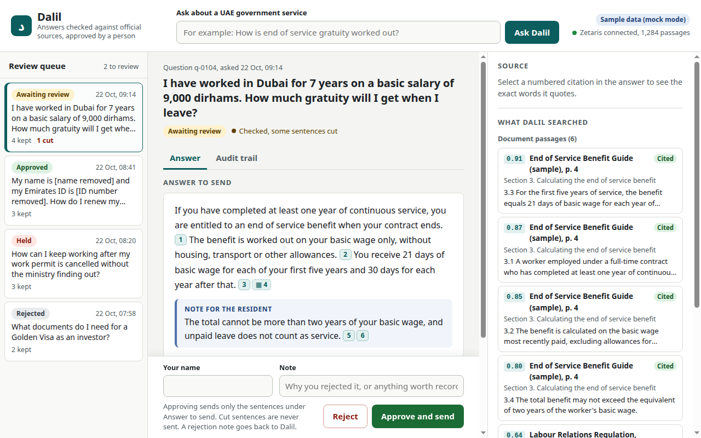
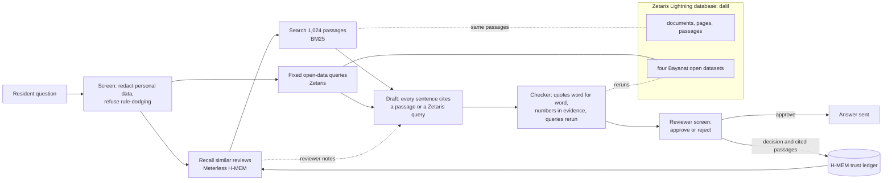

# Dalil

Answers about UAE government services, with every sentence tied to the official text it came from. A person approves each answer before it goes out.

Built for the Open Agent Hackathon 2026, Track 02, "The Agent That Can Explain Why", during the build window of 22 to 27 October 2026.

## What it does

1. You ask a question about a UAE government service.
2. Dalil screens it. Emirates ID, passport, phone and email details are redacted before anything is stored, and requests to get around the rules get a refusal. Reviewers' names and notes are redacted the same way.
3. It recalls past reviews from H-MEM, Meterless's memory engine. For a question that shares most of its key words with an earlier one, it leaves out the passages a reviewer rejected there, unless an approved answer to a similar question used them.
4. It searches 1,024 passages from 45 official documents, and runs fixed open-data queries through Zetaris when the question needs numbers.
5. It drafts an answer. Every sentence cites a passage, or a Zetaris query and the column its number comes from.
6. A checker tests every citation. A quote must appear word for word in its passage, every number in a sentence must appear in its evidence, and a data citation is rerun. Sentences that fail are cut, and an answer that loses too much is held.
7. A reviewer sees the answer, the exact passage behind each citation highlighted on its page, the sentences that were cut and why, and the audit trail. Nothing goes out until they approve it.
8. The decision is saved to H-MEM's trust ledger with the passages the answer cited. A rejection keeps those passages out of the next answer to a similar question, and its note is passed to the drafter. The extractive stand-in drafter cannot read notes; the Nemotron drafter will.



## How it fits together




## Run it

You need Python 3.13 with [uv](https://docs.astral.sh/uv/), Node 22.7 or later for the H-MEM bridge, and a Zetaris instance. This was built against Zetaris's free local version, 2.4.3.1.

```bash
uv sync
uv run python scripts/fetch_corpus.py            # download the documents into corpus/, for your own use
uv run python scripts/extract_corpus.py          # text per page -> build/documents.jsonl
uv run python scripts/build_passages.py          # passages with exact offsets -> build/passages.jsonl
cp .env.example .env                             # then fill in the Zetaris settings
uv run python scripts/load_zetaris.py            # documents, pages, passages and open data into Zetaris
uv run python scripts/check_zetaris.py           # counts, and a citation query rerun inside Zetaris
uv run python scripts/serve.py                   # app on http://127.0.0.1:8787, H-MEM bridge on 8788
```

The screen also runs on invented sample data with no backend: serve `web/` and open it with `?mock=1`.

Checks:

```bash
uv run pytest                                    # unit tests, synthetic text only
uv run python scripts/selftest_verify.py         # the checker against every real passage
uv run python scripts/eval_retrieval.py          # retrieval on the ten test questions
uv run python scripts/run_eval.py                # every test question and error scenario end to end
```

## Built with

| Part | What |
|---|---|
| Zetaris | Federated SQL over the documents, pages, passages and four Bayanat open datasets, all in one Lightning database. Citations to open data are Zetaris queries that the checker reruns |
| Meterless | H-MEM, vendored unchanged from Meterless's reference implementation, keeps approved answers and reviewers' rejections with their provenance in its append-only trust ledger |
| NVIDIA | Planned: Nemotron models for drafting, parsing and embeddings. Not wired yet; see below |
| Claude Code | Wrote the code; see [docs/tool-log.md](docs/tool-log.md) |

## Not done yet

- **Drafting.** The answer drafter is an extractive stand-in: it quotes whole source sentences, so its answers always pass the checker and read stiffly. A Nemotron drafter will replace it once the NVIDIA key is in place. `dalil/draft.py` holds the rules it must follow.
- **Dense retrieval.** Search is BM25 for now. `dalil/retrieve.py` has the hook for Nemotron embeddings.

## Data

See [data/README.md](data/README.md). The documents are public UAE government publications, but most of them may not be republished, so this repo holds the manifest and a fetch script, not the files.

## Pre-existing work

Declared under rule 4 of the hackathon rules:

- The document collection and its manifest, `data/MANIFEST.csv`, gathered from public sources before 22 October 2026.
- Planning notes with no code.
- A local install of Zetaris's free version, set up before the window from Zetaris's own bundle.

All code in this repo was written during the build window. [docs/tool-log.md](docs/tool-log.md) records which tool wrote what.

## Licence

Apache 2.0 for the code. The documents keep their publishers' terms.
